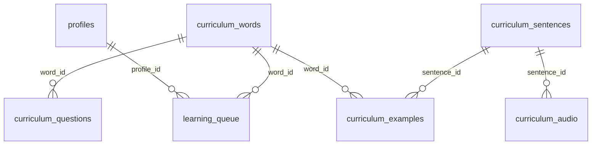

# Vocabulary data and question generation

Implementation checkpoint: 2026-11-06. Core study and sentence playback use local assets and SQLite; neither generation nor grading calls an AI service.

## Imported sources

| Source | Records in the pinned snapshot | Use |
|---|---:|---|
| [HearMandarin](https://hearmandarin.com/datasets/) | 11,147 words/senses | Main staging word list; CC BY 4.0 |
| [no7z/hsk-sentences-audio](https://github.com/no7z/hsk-sentences-audio) | 4,354 sentences; 8,708 normal/slow recording references | Examples and selected recordings; CC BY-SA 4.0 |
| [Zhongdex](https://github.com/saymei/zhongdex) | 11,092 words; 29,619 sentence records | Quarantined staging records, pending provenance and sense review |

`content/sources.lock.json` records exact HTTPS URLs, revisions, SHA-256 hashes and attribution. HearMandarin's JSON version is `2026-09-09`, generated `2026-09-28`. Sentence revision is `857dfbab91027ebd97df01260e91b817cb6b4854`; Zhongdex revision is `80974b41f5713b5ddc86e70554c100c13e0ab214`. Counts above come from imported files rather than repository marketing totals.

Zhongdex declares CC BY-SA 4.0 for data, but its NOTICE identifies unresolved upstream HSK-list provenance. Its per-definition and per-sentence source/license fields are retained in `raw_json`; all imported records remain quarantined. The 9,684 candidate word crosswalks match Hanzi and normalized pronunciation, not proven sense equivalence. These records are not distributed in learner packs. Zhongdex's audio availability metadata supplies no hosted playback URL; none is invented. The exact upstream notices are retained in `content/ZHONGDEX_NOTICE.txt` and `ZHONGDEX_DATA_LICENSE.txt`.

HearMandarin's exam bands and the sentence source's GF0025-2021 levels describe different lists. Store both, never silently equate them. The source includes synthetic speech; importing existing recordings does not imply human-recorded pronunciation.

## Supplemental corpus and device speech (revision 2)

The user requested [Roxaleen/hsk-annotated-corpus](https://github.com/Roxaleen/hsk-annotated-corpus). `content/roxaleen.lock.json` pins commit `dd6bc245038fdb0c93f7a29e380be15be671848b` and exact data hashes. The selected subset adds 15,609 example links from 13,846 distinct Tatoeba sentence/translation pairs. Original Chinese and English IDs/links, attribution and annotation status are retained in each sentence record. [Tatoeba's reuse guidance](https://en.wiki.tatoeba.org/articles/show/using-the-tatoeba-corpus) identifies CC BY 2.0 FR for sentence text.

`CorpusExamples` matches tagged words and pronunciation, confirms the original text/translation pair, checks generated contextual Pinyin against the target reading, ranks by source level/length, and fills only empty slots up to five. Existing examples, prepared lessons and all MP3s remain unchanged. Pinyin uses pinned pypinyin 0.55.0; this is an automatic annotation, not independent pronunciation review. Corpus tags do not establish semantic sense equivalence. The Wiktionary/Leipzig subsets are not published: record-level quotation rights and translated web-text provenance need separate resolution. No blanket license is invented for the repository.

Coverage is now 7,099 words with examples, 3,365 with five, and 4,048 with none. All 11,147 words remain quiz-able, with 85,118 questions. Curriculum/pack revision 2 triggers a transactional update while preserving IDs, saved queues, progress and old attempt snapshots; Drift schema remains 5.

Every word has Play word using an installed offline Mandarin TTS voice. Examples use their existing recording first, otherwise Read sentence invokes TTS. No generated MP3 or fabricated recording row is stored: speech text comes directly from the selected word/example record. One shared session controls both engines, prevents overlap, stops before quizzes/on route disposal, and handles missing voices and asynchronous failures. The app refuses English/Cantonese defaults and network-required voices. Generated speech can choose an incorrect reading; the displayed lesson Pinyin remains the guide. Device speech installation may require a one-time Windows download; subsequent speech uses the installed voice.

Reproduce supplemental imports (development only):

```powershell
.venv\Scripts\python.exe -m pip install -r scripts\requirements-content.txt
.venv\Scripts\python.exe scripts\fetch_corpus.py --fetch
.venv\Scripts\python.exe scripts\build_curriculum.py
```

## Full learning queue and relational curriculum (2026-11-07)

Vocabulary > Browse words opens a per-profile learning queue. The first word is selected by default; click any row to highlight it, then use the shared Learn button. Move up/down/to front changes the saved queue; Restore priority order preserves progress. Search covers the full queue. Completing the initial quiz removes the word from this queue and leaves it available in scheduled reviews.

SQL returns 20 rows plus one look-ahead row; See 20 more requests the next page. Only the selected lesson's examples and questions are reconstructed. The initial one-time install verifies and copies a 88,731,648-byte bundled SQLite database; this is separate from paginated screen loading. SHA-256 calculation runs in a background isolate, and the production database uses a background executor.

| Bundle coverage | Count |
|---|---:|
| Learnable words | 11,147 |
| Deterministic questions | 85,118 |
| Words with at least one sourced example | 7,099 |
| Words with five examples | 3,365 |
| Words with bundled sentence audio | 4,600 |
| Unique normal-speed MP3 files | 4,118 |
| MP3 bytes | 68,938,102 |

All words have seven core questions; eligible sourced cloze adds an eighth. The 21 prepared lessons retain their five examples and eight questions. The remaining lessons are explicitly source-imported, pending sense/context/teacher review. Content schema 4 permits zero to five sourced examples; older content schemas still require exactly five. No example sentences are fabricated; missing recordings use labelled device TTS. The user's explicit request to make every word learnable supersedes the earlier 21-lesson-only scope.



Schema 5 adds these normalized tables plus a curriculum install marker. Primary and foreign keys connect every question to its word and every recording to its sentence; the word/sentence join supports sentence reuse. Indexes cover queue order, question lookup and sentence audio lookup. The old content tables and immutable learner history remain. The original greeting uses `starter.greeting.nihao.1`, avoiding a duplicate queue item and preserving old attempts.

`scripts/build_curriculum.py` builds the offline seed from checksum-pinned sources, priorities and existing prepared packs. Sentence selection matches Hanzi AND normalized pronunciation, not Hanzi alone. A bounded deterministic distractor pool per band/part of speech makes bulk question generation practical. Exact source-level/word-band provenance is retained; those systems are not interchangeable. Sense matching and semantic ambiguity still need editorial review.

Runtime installation verifies the manifest digest, checks SQLite integrity/foreign keys, and installs all content in one transaction. Parent rows use UPSERT to preserve queue relationships. Failure rolls back; a later retry works. Same-revision changes are rejected and older bundled revisions cannot downgrade installed content. Increase the builder's manifest revision when publishing a changed seed. Never delete a learner database to refresh content.

## Storage boundaries

The developer staging database `.content-cache/content_staging.sqlite` holds bulk data and candidates. It is ignored by Git and is not a learner database. Tables include:

- `sources`, `words`, `word_senses`: stable source IDs, Simplified/Traditional Hanzi, marked/numbered Pinyin, English gloss, part of speech, bands and provenance.
- `word_priorities`: an explicit tier, rank and basis for every imported word.
- `sentences`, `sentence_tokens`, `sentence_grammar_tags`, `word_sentence_links`: source sentences and 22,955 candidate links using exact source-token matches.
- `exercises`, `exercise_options`: the 160 questions selected for the 20 imported lessons.
- `draft_exercises`: 2,349 generated questions for 300 band-one words, explicitly draft. Missing source examples reduce the available patterns; no sentences are invented.
- `external_words`, `external_sentences`, `word_crosswalk`: quarantined Zhongdex records and candidate identity mappings.
- `audio_assets`: 8,708 source references; the original starter lock covers 88 normal-speed recordings; the full curriculum adds 4,030 through a separate lock. Unselected/slow recordings remain references.

Staging uses bound SQL values, integrity/foreign-key checks and atomic file replacement. Invalid inputs leave the previous staging database intact. This database can be rebuilt without touching learner history.

The retained Drift schema **4** content tables hold `content_packs → content_words → content_examples/content_exercises`. Packs retain a canonical validated JSON copy, revision and content-schema version; lesson rows are reconstructed and checked against it on load. Both bundles are validated before a transaction installs them. Repeated imports are idempotent; changed content at the same revision is rejected; older bundles cannot downgrade an installed pack.

`vocabulary_progress` and `review_attempts` remain separate. Content replacement cascades only through content children. Stable sense IDs and historical question snapshots preserve existing attempts, including old two-question greeting attempts. Never delete or reset a learner database to refresh content. See [migration and backup procedures](MIGRATIONS.md).

## Object-oriented question generator

`scripts/question_generation.py` separates immutable `Word`, `Example`, `Choice` and `Question` models from `QuestionPattern` strategies. `QuestionBankGenerator` composes patterns; `DistractorSelector` indexes source words by band, prefers matching parts of speech and deterministically selects options. A new pattern can be registered without rewriting the importer.

| Pattern | Prompt → answer |
|---|---|
| `meaning` | Hanzi → English |
| `hanzi` | English → Hanzi |
| `pinyin` | Hanzi → marked Pinyin |
| `pinyin_hanzi` | Pinyin with meaning context → Hanzi |
| `meaning_pinyin` | English → Pinyin |
| `pinyin_meaning` | Pinyin → lesson meaning |
| `cloze` | Existing sentence and translation → missing Hanzi |
| `typed_hanzi` | Lesson meaning → typed Simplified Chinese |

Multiple-choice distractors are other imported words at or below the target band (band zero uses band one). Same Hanzi, same normalized Pinyin, duplicate option text and overlapping listed glosses are excluded. This lexical filter does not prove that all semantic ambiguity is eliminated; editorial review remains necessary. Insufficient safe distractors produce an explicit skipped-word reason. Cloze requires one occurrence of the target in an existing example. Typed recall accepts the exact lesson word with documented whitespace normalization, not arbitrary synonyms or AI judgments. Runtime shuffling changes option positions by attempt while retaining stable answer IDs.

## Published starter lessons and audio

The prepared subset contains **21 lessons, five examples each, eight questions each: 168 questions** within the full curriculum above. Twenty lessons use HearMandarin words and selected no7z examples. The original greeting retains stable ID `starter.greeting.nihao.1` at revision 3. The imported lesson pack is revision 2. Asset filenames remain stable; the JSON envelope carries the authoritative revision. `starter_greeting_v1.json` remains a legacy test/migration fixture and is not bundled.

`content/starter_selection.json` identifies every selected example and six explicit Pinyin corrections: one copula reading and five occurrences of the dictionary reading for 学生. Source recordings remain unmodified. All lessons display `source-checked-pilot`; independent teacher and listening review are pending. The draft bank is not automatically published as approved curriculum.

The 20 imported lessons have 100 example links to **88 distinct MP3s**, totaling **1,234,848 bytes**. `content/audio.lock.json` records each original URL, hash, size, voice and synthetic status. The files are bundled in `assets/audio/`; playback never fetches a remote URL. There is one active sentence player, explicit stop, completion handling and retry on errors. Entering a quiz stops playback. Reading and quizzes remain usable if playback fails. Standalone word audio and original greeting-example audio are unavailable.

The distributed adaptations and recordings retain CC BY-SA 4.0 attribution, HearMandarin CC BY 4.0 attribution and CC-CEDICT contributor credit. Notices and complete license texts ship under `assets/content/` and are accessible from the queue information button. The source repository's speech-model license does not replace its recording/data license.

## Reproduce and extend

From the repository root:

```powershell
# First import: download only locked data and missing selected recordings.
.venv\Scripts\python.exe scripts\import_content.py --fetch
# Subsequent imports work offline from the checksum-verified cache.
.venv\Scripts\python.exe scripts\import_content.py
# Build the full curriculum, fetch missing pinned normal recordings, then relink.
.venv\Scripts\python.exe scripts\build_curriculum.py
.venv\Scripts\python.exe scripts\fetch_curriculum_audio.py --fetch
.venv\Scripts\python.exe scripts\build_curriculum.py
.venv\Scripts\python.exe -m unittest discover -s scripts -p "test_*.py"
```

Upstream content changes fail checksum verification. Review a new snapshot and its rights before updating the lock. To expand publication, review target senses and five examples, record selection/corrections and audio provenance, then increment an already-shipped pack's revision. Keep stable sense IDs. Run Python import/generator checks, Dart parser/repository/migration tests, the learning journey and native playback checks. A clean fetch requires network access; normal app use does not.

Future work: independent content/listening review, richer sense disambiguation, reviewed slow-audio selection, audio-recognition and sentence-order questions, and broader publication. The current early-review scheduler still makes no mastery or FSRS claim.

## Full in-app dictionary and learning priority

All **11,147 HearMandarin entries** remain in `assets/content/dictionary_v1.json` as the rebuild source. The production Learn route uses the relational curriculum and paginated queue above. Every entry now has a lesson and question bank; this replaces the previous read-only catalogue/pending-lesson split. Opening a lesson alone does not create a completed attempt or mastery.

`learning_priority.py` assigns transparent versioned priorities, persisted in staging and bundled metadata. The app's `LearningPriority` model applies the same ordering: tier, source band, within-band order, stable ID. Catalogue lessons sort by this priority too. Priorities guide the list without locking access.

| Priority | Rule | Current word count |
|---|---|---:|
| Start here | Explicit 26-word greeting/pronoun/basic-function/verb/time starter list, restricted to source band one | 26 |
| Beginner | Remaining source bands 1–2 | 474 |
| Intermediate | Source bands 3–4 | 1,500 |
| Advanced | Source bands 5–7 | 9,000 |
| Unranked | Missing HSK 3.0 band/sequence, retained without inventing a level | 147 |

The starting order begins 你好, 我, 你, 他, 她, 我们. The editorial starter list is not a corpus frequency measurement; HSK bands are a coarse curriculum guide, and source sequence is only a stable tie-breaker. Individual difficulty depends on the learner. The queue follows these defaults until the learner changes its order; no AI ranks or generates the words.
